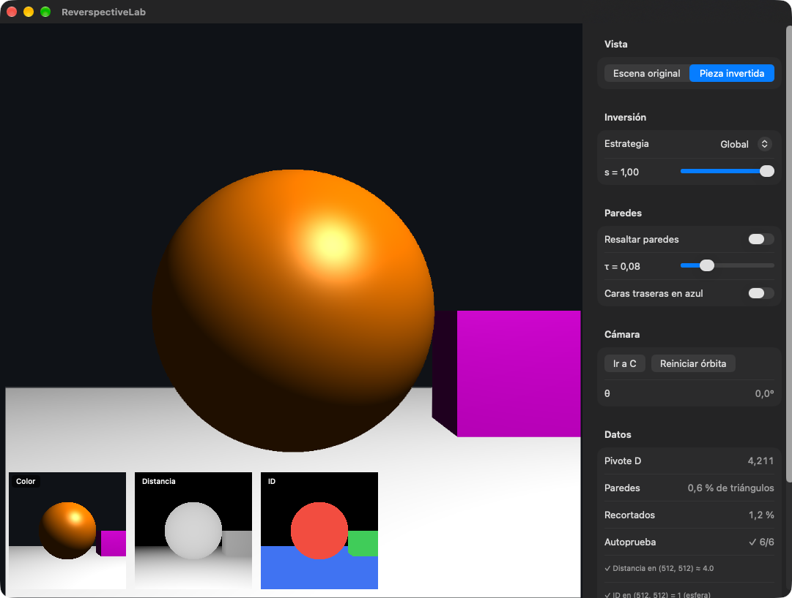

# ReverspectiveLab

Genera **reverspectivas** automáticamente a partir de una escena 3D. Una
reverspectiva (Patrick Hughes) es una pieza cuyo relieve está invertido
respecto a la imagen pintada encima: lo que parece cerca está lejos. Al
moverse el observador, la escena parece girar al revés y "seguirlo".

Proyecto final de Computación Visual Interactiva (Uniandes). La pregunta de
investigación compara el ángulo máximo de visión θ_max que predice la
geometría con el ángulo al que la gente reporta que la ilusión se rompe.



## Qué hace (v0.2)

1. Toma tres fotos de la escena desde una cámara fija C: color, distancia
   radial e ID de objeto (miniaturas abajo a la izquierda).
2. Convierte las fotos (1024×1024) en una rejilla de triángulos, un
   vértice por píxel.
3. Mueve cada vértice sobre su rayo según una estrategia de inversión:
   **Global**, **Por objeto** o **Híbrida**, con un factor `s`.
4. Muestra la pieza con la foto de color pegada. Desde C se ve idéntica a
   la escena; al orbitar alrededor de ella, el movimiento se invierte.
5. Marca en rojo las **paredes** (triángulos estirados que rompen la
   ilusión) y muestra θ y el % de paredes.

## Requisitos

- macOS 27 con chip Apple, Xcode 27.
- Sin dependencias externas: Swift, SwiftUI, Metal, MetalKit, ModelIO y simd.

## Compilar y probar

```sh
# La app
xcodebuild -project ReverspectiveLab.xcodeproj -scheme ReverspectiveLab \
  -destination 'platform=macOS' build

# Las pruebas del núcleo matemático (sin GPU)
swift test
```

O abrir `ReverspectiveLab.xcodeproj` en Xcode y correr (⌘R). En Debug, la
consola muestra la autoprueba de arranque; el panel también la muestra.

## Controles

- **Orbitar:** dos dedos en el trackpad, o botón central del mouse y
  arrastrar. La órbita gira alrededor del centro de la pieza (P).
- **Zoom:** pellizco en el trackpad, o rueda del mouse.
- **Panel derecho:** vista, estrategia y `s`, paredes, "Ir a C" y datos.

## Estructura

| Carpeta | Contenido |
|---|---|
| `ReverspectiveLab/App/` | SwiftUI: ventana, panel, estado compartido |
| `ReverspectiveLab/Rendering/` | Todo lo que toca Metal: renderer, fotos, pieza, miniaturas, autoprueba |
| `ReverspectiveLab/Core/` | Matemática pura (sin Metal), probada con `swift test` |
| `ReverspectiveLab/Scene/` | Escena de prueba, objetos, formato de vértices |
| `ReverspectiveLab/Shaders/` | Todos los shaders |
| `Tests/ReverspectiveCoreTests/` | Pruebas del núcleo |
| `docs/` | Requisitos por release y bitácora (`BITACORA.md`) |

La bitácora explica, hito por hito, qué se hizo y los conceptos de Swift y
Metal que aparecen. Al final tiene el guion de la demo.
